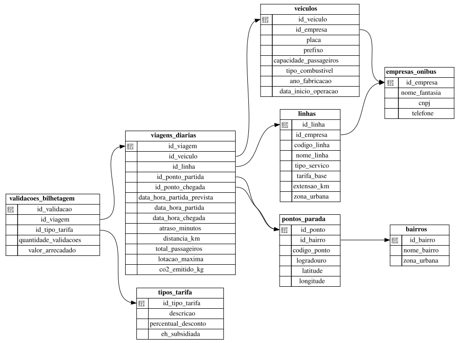
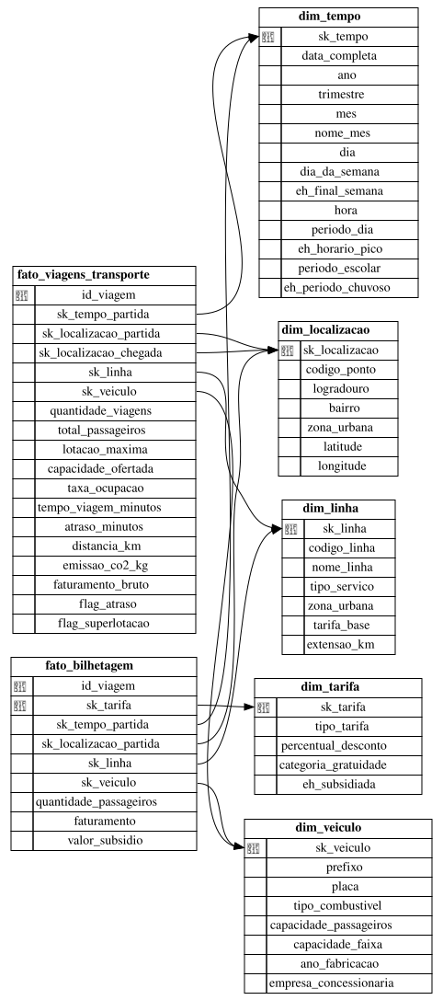

# Trabalho: TEBD 2026.2 UNEB
## Hugo Alves, Victor Bitencourt

Laboratório de Dados para Cidades Sustentáveis: **Mobilidade Urbana em Salvador** (ODS 11, Meta 11.2).

## Requisitos

- Instalar: `uv`

    - [https://docs.astral.sh/uv/](https://docs.astral.sh/uv/)

- Instalar projeto: `uv sync`

- (Opcional) `sqlite3` para inspecionar os bancos.

## Como executar

Tudo do zero (cria os bancos, gera os dados, faz o ETL, a mineração e os dashboards, em cerca de 30 s):

```bash
uv run src/tebd_trab/pipeline.py
```

Depois, abra `dashboard/index.html` no navegador (funciona offline).

Etapas individuais:

| Etapa | Comando | Saída |
| :--- | :--- | :--- |
| Criar bancos | `uv run src/tebd_trab/migrate.py --reset` | `oltp.db`, `olap.db` |
| Dados sintéticos | `uv run src/tebd_trab/gerar_dados.py` | OLTP populado |
| ETL | `uv run src/tebd_trab/etl.py` | Data Warehouse carregado |
| Mineração | `uv run src/tebd_trab/mineracao.py` | `docs/figuras/` |
| Dashboards | `uv run src/tebd_trab/dashboard.py` | `dashboard/index.html`, `docs/07_09_dashboards.md` |

> **Sobre os dados:** como não há acesso a dados reais de GPS e bilhetagem, o projeto usa **dados sintéticos e reprodutíveis** (semente fixa) que simulam 18 linhas, 176 ônibus e cerca de 264 mil viagens em Salvador entre jan/2022 e nov/2026. Empresas, placas e CNPJs são fictícios. O pipeline funcionaria igual com dados reais carregados no OLTP.

## Estrutura do repositório

```
oltp_migrations/          Script de construção do OLTP (8 entidades)
olap_migrations/          Script de construção do OLAP (5 dimensões + 2 fatos)
sql/etl_oltp_para_olap.sql   ETL em SQL (OLTP -> OLAP)
consultas/                15 consultas: operacional, tático e estratégico
src/tebd_trab/            Scripts Python (migração, dados, ETL, mineração, dashboard)
docs/                     Itens 6, 7-9 e 10 + figuras
dashboard/index.html      Dashboard interativo
dicionario.md             Dicionário de dados
schema_oltp.svg / schema_olap.svg   Diagramas dos modelos
```

## Problematização

O crescimento desordenado das áreas urbanas impõe desafios complexos à mobilidade das populações. Nas grandes cidades, o sistema de transporte público frequentemente sofre com atrasos crônicos, frotas obsoletas, superlotação e falta de integração entre diferentes modais (ônibus, metrô, trens).
Sem dados integrados, os gestores públicos e as empresas concessionárias operam no escuro: não conseguem identificar quais linhas são ineficientes, quais horários concentram os maiores gargalos e como o tempo de espera impacta a qualidade de vida do cidadão. Além disso, o setor de transporte é um dos maiores emissores de gases de efeito estufa nas cidades, e a falta de planejamento impede a transição para frotas mais limpas.
A ausência de uma visão analítica centralizada fragmenta as tomadas de decisão, resultando em um sistema caro, poluente e ineficaz para quem mais precisa dele.

## Justificativa (Alinhamento com o ODS 11)

Este projeto está diretamente alinhado com o ODS 11: Cidades e Comunidades Sustentáveis, mais especificamente com a Meta 11.2, que visa, até 2030, proporcionar o acesso a sistemas de transporte seguros, acessíveis, sustentáveis e a preço acessível para todos, melhorando a segurança rodoviária por meio da expansão dos transportes públicos.
A criação de um Data Warehouse (DW) focado na mobilidade urbana justifica-se pela necessidade de transformar registros brutos (como dados de GPS dos ônibus e bilhetagem eletrônica) em inteligência estratégica. Através da modelagem multidimensional, o projeto viabiliza:
- Inclusão Social: Identificar bairros periféricos desatendidos ou com tarifas desproporcionais ao tempo de viagem.
- Sustentabilidade Ambiental: Monitorar e incentivar a substituição de veículos movidos a combustíveis fósseis por modais elétricos ou híbridos, calculando a redução na emissão de CO₂.
- Eficiência Operacional: Otimizar frotas para reduzir congestionamentos e o tempo de deslocamento da população, tornando as cidades mais resilientes e inteligentes.

## Requisitos do Sistema (Data Warehouse)

Para que o modelo multidimensional responda às dores da problematização, o sistema deve atender aos seguintes requisitos:

Requisitos de Negócio (Perguntas que o DW deve responder)

- Análise de Pontualidade: Qual é o índice de atraso médio por linha de ônibus durante os horários de pico (7h-9h e 17h-19h)? → consulta **T1**
- Otimização de Demanda: Quais linhas apresentam superlotação sistemática e necessitam de reforço na frota? → consulta **T2**
- Perfil do Usuário: Qual é o percentual de passageiros que utilizam tarifas subsidiadas (estudantes/idosos) por região da cidade? → consulta **T3**
- Impacto Ecológico: Qual é a estimativa de emissão de carbono por quilômetro rodado nas diferentes zonas urbanas? → consulta **E1**

### Requisitos Técnicos e de Dados

- Granularidade da Fato: Cada registro na tabela fato de viagens representa uma viagem individualizada realizada por um veículo entre um ponto de partida e um ponto de chegada (garantido pela dimensão degenerada `id_viagem` como chave primária).
- Histórico Temporal: O sistema armazena dados históricos de 5 anos (2022-2026) para análise de tendências sazonais (ex.: período de férias escolares vs. período letivo, período chuvoso).
- Dimensão Geográfica: Capacidade de agregar e filtrar os dados por múltiplos níveis de hierarquia espacial (Ponto de Parada -> Bairro -> Zona Urbana).
- Performance de Consulta: O modelo dimensional (constelação de fatos com dimensões conformadas) é otimizado para consultas rápidas de agregação (Soma, Média, Percentual), evitando cruzamentos (joins) complexos que travariam um banco de dados transacional (OLTP).

## Modelagem

**OLTP**: 8 entidades normalizadas (`empresas_onibus`, `veiculos`, `linhas`, `bairros`, `pontos_parada`, `tipos_tarifa`, `viagens_diarias`, `validacoes_bilhetagem`).



**OLAP**: constelação de fatos. `fato_viagens_transporte` (grão: viagem) e `fato_bilhetagem` (grão: viagem × tarifa) compartilham as dimensões tempo, localização, linha e veículo; `dim_tarifa` é exclusiva da bilhetagem.



Detalhes de cada atributo em [dicionario.md](./dicionario.md).

## Entregáveis

| # | Item | Onde |
| :--- | :--- | :--- |
| 1 | Contextualização | Este README |
| 2 | Modelagem OLTP | `oltp_migrations/`, `schema_oltp.svg` |
| 3 | Modelagem OLAP | `olap_migrations/`, `schema_olap.svg` |
| 4 | Dicionário de dados | [dicionario.md](./dicionario.md) |
| 5 | Script de construção | `oltp_migrations/*.sql`, `olap_migrations/*.sql`, `sql/etl_oltp_para_olap.sql` |
| 6 | Análise exploratória e mineração (Árvore de Decisão) | [docs/06_analise_exploratoria.md](./docs/06_analise_exploratoria.md) |
| 7 | Dashboard operacional (5 consultas) | `consultas/01_operacional.sql` · [docs/07_09_dashboards.md](./docs/07_09_dashboards.md) |
| 8 | Dashboard tático (5 consultas) | `consultas/02_tatico.sql` · [docs/07_09_dashboards.md](./docs/07_09_dashboards.md) |
| 9 | Dashboard estratégico (5 consultas) | `consultas/03_estrategico.sql` · [docs/07_09_dashboards.md](./docs/07_09_dashboards.md) |
| 10 | Plano de ação 5W2H | [docs/10_plano_acao_5w2h.md](./docs/10_plano_acao_5w2h.md) |

## TODO

- [x] Contextualização

- [x] Modelagem OLTP

- [x] Modelagem OLAP

- [x] Dicionário de dados

- [x] Script de construção

- [x] Análise exploratória de dados (Definição de um problema e adoção de um método de mineração de dados para a resolução e explicação do método)

- [x] Dashboard operacional (Mínimo de 5 consultas (enunciado + código) voltadas ao nível operacional.)

- [x] Dashboard tático (Mínimo de 5 consultas (enunciado + código) voltadas ao nível tático.)

- [x] Dashboard estratégico (Mínimo de 5 consultas (enunciado + código) voltadas ao nível estratégico.)

- [x] Plano de ação (5w2h) (Criação de um plano de ação para orientar tarefas a partir do processo de tomada de decisão)
