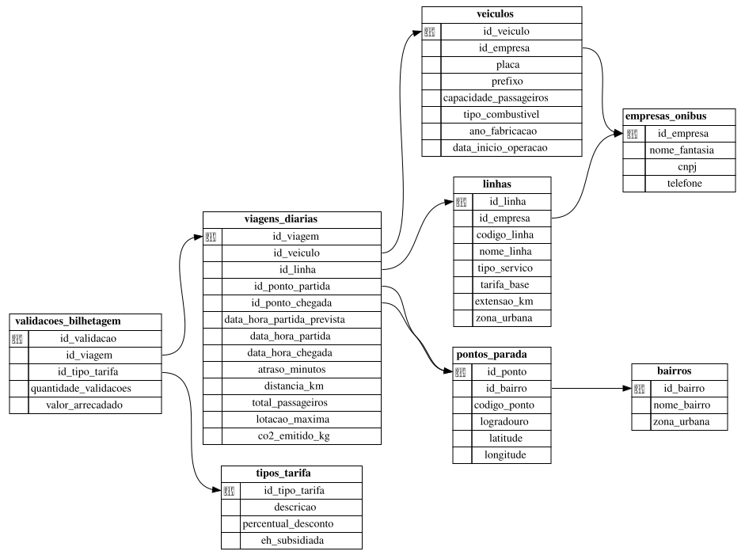
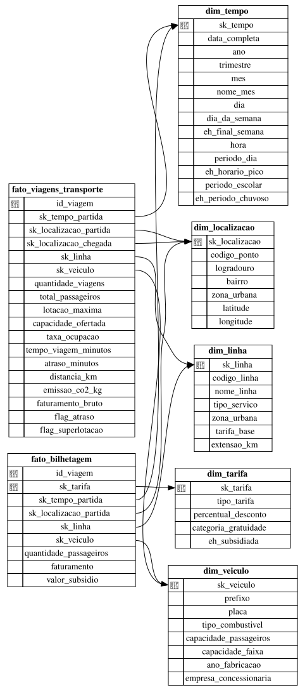

# Dicionário de Dados - Sistema de Mobilidade Urbana (TEBD 2026.2)

Este documento apresenta o **Dicionário de Dados** do sistema de transporte público desenvolvido para a disciplina de Tópicos Especiais em Banco de Dados (TEBD), alinhado ao **ODS 11 (Cidades e Comunidades Sustentáveis)**.

O projeto é dividido em duas arquiteturas:

1. **OLTP (Transacional)** - `oltp.db`: operação diária (frota, linhas, pontos, viagens e bilhetagem). Modelo normalizado com **8 entidades**.
2. **OLAP (Data Warehouse)** - `olap.db`: modelo multidimensional em **constelação de fatos** (*fact constellation*): duas tabelas fato que compartilham dimensões conformadas.

Convenções:

- SGBD: **SQLite 3**. Tipos: `INTEGER`, `REAL`, `TEXT`. Datas/horas são `TEXT` no formato ISO-8601 (`AAAA-MM-DD HH:MM:SS`).
- Valores booleanos são `INTEGER` com `CHECK (... IN (0, 1))`.
- PK = chave primária, FK = chave estrangeira, UK = único, NN = `NOT NULL`, CK = `CHECK`.
- O SQLite só verifica FKs com `PRAGMA foreign_keys = ON` (ativado pelos scripts do projeto).

---

## 1. Camada OLTP (Banco Transacional)

### 1.1. `empresas_onibus`
Empresas concessionárias responsáveis pela operação das linhas.

| Coluna | Tipo | Restrições | Descrição |
| :--- | :--- | :--- | :--- |
| `id_empresa` | `INTEGER` | PK, `AUTOINCREMENT` | Identificador da empresa. |
| `nome_fantasia` | `TEXT` | NN | Nome comercial da empresa. |
| `cnpj` | `TEXT` | UK, NN | CNPJ da empresa. |
| `telefone` | `TEXT` | - | Telefone de contato. |

### 1.2. `veiculos`
Frota de ônibus, com especificações técnicas e ambientais.

| Coluna | Tipo | Restrições | Descrição |
| :--- | :--- | :--- | :--- |
| `id_veiculo` | `INTEGER` | PK, `AUTOINCREMENT` | Identificador do veículo. |
| `id_empresa` | `INTEGER` | FK → `empresas_onibus`, NN | Empresa proprietária/operadora. |
| `placa` | `TEXT` | UK, NN | Placa (padrão Mercosul). |
| `prefixo` | `TEXT` | UK, NN | Código interno do ônibus na frota. |
| `capacidade_passageiros` | `INTEGER` | NN, CK `> 0` | Capacidade total (sentados + em pé). |
| `tipo_combustivel` | `TEXT` | NN, CK ∈ {Diesel, GNV, Híbrido, Elétrico} | Matriz energética do veículo. |
| `ano_fabricacao` | `INTEGER` | - | Ano de fabricação (usado para calcular idade da frota). |
| `data_inicio_operacao` | `TEXT` | NN | Data em que o veículo entrou em operação. |

### 1.3. `linhas`
Linhas de transporte operadas no município.

| Coluna | Tipo | Restrições | Descrição |
| :--- | :--- | :--- | :--- |
| `id_linha` | `INTEGER` | PK, `AUTOINCREMENT` | Identificador da linha. |
| `id_empresa` | `INTEGER` | FK → `empresas_onibus`, NN | Concessionária que opera a linha. |
| `codigo_linha` | `TEXT` | UK, NN | Código oficial da linha (ex.: `L201`). |
| `nome_linha` | `TEXT` | NN | Nome descritivo (ex.: "Cajazeiras - Lapa"). |
| `tipo_servico` | `TEXT` | NN, CK ∈ {Convencional, Expresso, Circular, Alimentadora} | Categoria do serviço. |
| `tarifa_base` | `REAL` | NN, CK `>= 0` | Tarifa cheia (R$). |
| `extensao_km` | `REAL` | NN, CK `> 0` | Extensão nominal do itinerário (km). |
| `zona_urbana` | `TEXT` | NN | Zona de origem da linha (Centro, Orla, Miolo, Subúrbio). |

### 1.4. `bairros`
Bairros do município, com sua zona urbana. É o que permite a hierarquia **Ponto → Bairro → Zona**.

| Coluna | Tipo | Restrições | Descrição |
| :--- | :--- | :--- | :--- |
| `id_bairro` | `INTEGER` | PK, `AUTOINCREMENT` | Identificador do bairro. |
| `nome_bairro` | `TEXT` | UK, NN | Nome do bairro. |
| `zona_urbana` | `TEXT` | NN | Zona urbana a que o bairro pertence. |

### 1.5. `pontos_parada`
Pontos de ônibus e estações geolocalizados.

| Coluna | Tipo | Restrições | Descrição |
| :--- | :--- | :--- | :--- |
| `id_ponto` | `INTEGER` | PK, `AUTOINCREMENT` | Identificador do ponto. |
| `id_bairro` | `INTEGER` | FK → `bairros`, NN | Bairro onde o ponto fica. |
| `codigo_ponto` | `TEXT` | UK, NN | Código do ponto (ex.: `PT-1001`). |
| `logradouro` | `TEXT` | NN | Rua, avenida ou terminal. |
| `latitude` | `REAL` | - | Latitude (WGS84). |
| `longitude` | `REAL` | - | Longitude (WGS84). |

### 1.6. `tipos_tarifa`
Perfis tarifários dos passageiros.

| Coluna | Tipo | Restrições | Descrição |
| :--- | :--- | :--- | :--- |
| `id_tipo_tarifa` | `INTEGER` | PK, `AUTOINCREMENT` | Identificador do tipo de tarifa. |
| `descricao` | `TEXT` | UK, NN | Inteira, Vale-Transporte, Estudante (Meia), Idoso, PcD. |
| `percentual_desconto` | `REAL` | NN, `DEFAULT 0`, CK 0 a 100 | Desconto sobre a tarifa base (%). |
| `eh_subsidiada` | `INTEGER` | NN, `DEFAULT 0`, CK ∈ {0,1} | 1 = tarifa custeada (total ou parcialmente) pelo poder público. |

### 1.7. `viagens_diarias`
Registro de cada viagem realizada (telemetria GPS e contador de passageiros).

| Coluna | Tipo | Restrições | Descrição |
| :--- | :--- | :--- | :--- |
| `id_viagem` | `INTEGER` | PK, `AUTOINCREMENT` | Identificador da viagem. |
| `id_veiculo` | `INTEGER` | FK → `veiculos`, NN | Veículo que fez a viagem. |
| `id_linha` | `INTEGER` | FK → `linhas`, NN | Linha operada. |
| `id_ponto_partida` | `INTEGER` | FK → `pontos_parada`, NN | Ponto inicial. |
| `id_ponto_chegada` | `INTEGER` | FK → `pontos_parada`, NN | Ponto final. |
| `data_hora_partida_prevista` | `TEXT` | NN | Horário programado de partida. |
| `data_hora_partida` | `TEXT` | NN | Horário real de partida (GPS). |
| `data_hora_chegada` | `TEXT` | - | Horário real de chegada (GPS). |
| `atraso_minutos` | `INTEGER` | NN, `DEFAULT 0` | Partida real − partida prevista, em minutos. |
| `distancia_km` | `REAL` | NN, CK `> 0` | Distância percorrida medida pelo GPS (km). |
| `total_passageiros` | `INTEGER` | NN, CK `>= 0` | Total de embarques na viagem. |
| `lotacao_maxima` | `INTEGER` | NN, CK `>= 0` | Maior número simultâneo de passageiros a bordo (sensor APC). |
| `co2_emitido_kg` | `REAL` | NN, `DEFAULT 0` | CO₂ estimado da viagem (kg) = distância × fator do combustível × ajuste por idade. |

### 1.8. `validacoes_bilhetagem`
Validações de bilhete agregadas por viagem e tipo de tarifa. Resolve o fato de uma mesma viagem transportar passageiros de vários perfis tarifários.

| Coluna | Tipo | Restrições | Descrição |
| :--- | :--- | :--- | :--- |
| `id_validacao` | `INTEGER` | PK, `AUTOINCREMENT` | Identificador do registro. |
| `id_viagem` | `INTEGER` | FK → `viagens_diarias`, NN | Viagem em que ocorreram as validações. |
| `id_tipo_tarifa` | `INTEGER` | FK → `tipos_tarifa`, NN | Perfil tarifário. |
| `quantidade_validacoes` | `INTEGER` | NN, CK `>= 0` | Número de passageiros desse perfil na viagem. |
| `valor_arrecadado` | `REAL` | NN, CK `>= 0` | Receita (R$) = quantidade × tarifa base × (1 − desconto). |

Restrição adicional: `UNIQUE (id_viagem, id_tipo_tarifa)`.

---

## 2. Camada OLAP (Data Warehouse)

A carga é feita por `sql/etl_oltp_para_olap.sql` (carga completa). As dimensões usam **chaves substitutas** (`sk_*`). O `id_viagem` do OLTP é mantido nas fatos como **dimensão degenerada**, o que garante o grão "uma viagem" e permite rastrear a origem.

### 2.1. Dimensões

#### `dim_tempo` (grão: hora)

| Coluna | Tipo | Restrições | Descrição |
| :--- | :--- | :--- | :--- |
| `sk_tempo` | `INTEGER` | PK | Chave inteligente `AAAAMMDDHH` (ex.: `2026110607`). |
| `data_completa` | `TEXT` | NN | Data `AAAA-MM-DD`. |
| `ano` | `INTEGER` | NN | Ano. |
| `trimestre` | `INTEGER` | NN, CK 1 a 4 | Trimestre. |
| `mes` | `INTEGER` | NN, CK 1 a 12 | Mês. |
| `nome_mes` | `TEXT` | NN | Nome do mês. |
| `dia` | `INTEGER` | NN, CK 1 a 31 | Dia do mês. |
| `dia_da_semana` | `TEXT` | NN | Nome do dia da semana. |
| `eh_final_semana` | `INTEGER` | NN, CK ∈ {0,1} | 1 = sábado ou domingo. |
| `hora` | `INTEGER` | NN, CK 0 a 23 | Hora do dia. |
| `periodo_dia` | `TEXT` | NN | Madrugada (0-4h), Manhã (5-6h), Pico Manhã (7-8h), Vale (9-16h), Pico Tarde (17-18h), Noite (19-23h). |
| `eh_horario_pico` | `INTEGER` | NN, CK ∈ {0,1} | 1 = 7h-9h ou 17h-19h. |
| `periodo_escolar` | `TEXT` | NN, CK ∈ {Letivo, Férias} | Férias = janeiro, julho e dezembro. |
| `eh_periodo_chuvoso` | `INTEGER` | NN, CK ∈ {0,1} | 1 = abril a julho (estação chuvosa de Salvador). |

#### `dim_localizacao`

| Coluna | Tipo | Restrições | Descrição |
| :--- | :--- | :--- | :--- |
| `sk_localizacao` | `INTEGER` | PK, `AUTOINCREMENT` | Chave substituta. |
| `codigo_ponto` | `TEXT` | UK, NN | Código do ponto (chave natural). |
| `logradouro` | `TEXT` | NN | Logradouro do ponto. |
| `bairro` | `TEXT` | NN | Bairro (nível 2 da hierarquia). |
| `zona_urbana` | `TEXT` | NN | Zona urbana (nível 3 da hierarquia). |
| `latitude` | `REAL` | - | Latitude. |
| `longitude` | `REAL` | - | Longitude. |

#### `dim_linha`

| Coluna | Tipo | Restrições | Descrição |
| :--- | :--- | :--- | :--- |
| `sk_linha` | `INTEGER` | PK, `AUTOINCREMENT` | Chave substituta. |
| `codigo_linha` | `TEXT` | UK, NN | Código oficial da linha. |
| `nome_linha` | `TEXT` | NN | Nome da linha. |
| `tipo_servico` | `TEXT` | NN | Convencional, Expresso, Circular, Alimentadora. |
| `zona_urbana` | `TEXT` | NN | Zona de origem da linha. |
| `tarifa_base` | `REAL` | NN | Tarifa cheia (R$). |
| `extensao_km` | `REAL` | NN | Extensão nominal (km). |

#### `dim_veiculo`

| Coluna | Tipo | Restrições | Descrição |
| :--- | :--- | :--- | :--- |
| `sk_veiculo` | `INTEGER` | PK, `AUTOINCREMENT` | Chave substituta. |
| `prefixo` | `TEXT` | UK, NN | Prefixo do veículo (chave natural). |
| `placa` | `TEXT` | NN | Placa. |
| `tipo_combustivel` | `TEXT` | NN | Diesel, GNV, Híbrido, Elétrico. |
| `capacidade_passageiros` | `INTEGER` | NN | Capacidade numérica. |
| `capacidade_faixa` | `TEXT` | NN | Até 70, 71-90, Acima de 90. |
| `ano_fabricacao` | `INTEGER` | - | Ano de fabricação. |
| `empresa_concessionaria` | `TEXT` | NN | Nome da empresa (desnormalizado). |

#### `dim_tarifa`

| Coluna | Tipo | Restrições | Descrição |
| :--- | :--- | :--- | :--- |
| `sk_tarifa` | `INTEGER` | PK, `AUTOINCREMENT` | Chave substituta. |
| `tipo_tarifa` | `TEXT` | UK, NN | Descrição da tarifa. |
| `percentual_desconto` | `REAL` | NN | Desconto (%). |
| `categoria_gratuidade` | `TEXT` | NN | Nenhuma, Desconto parcial (50%), Isenção total. |
| `eh_subsidiada` | `INTEGER` | NN, CK ∈ {0,1} | 1 = custeada pelo poder público. |

### 2.2. `fato_viagens_transporte` (grão: uma viagem)

| Coluna | Tipo | Restrições | Descrição |
| :--- | :--- | :--- | :--- |
| `id_viagem` | `INTEGER` | PK | Dimensão degenerada (id da viagem no OLTP). |
| `sk_tempo_partida` | `INTEGER` | FK → `dim_tempo`, NN | Hora **programada** de partida. |
| `sk_localizacao_partida` | `INTEGER` | FK → `dim_localizacao`, NN | Ponto de partida. |
| `sk_localizacao_chegada` | `INTEGER` | FK → `dim_localizacao`, NN | Ponto de chegada. |
| `sk_linha` | `INTEGER` | FK → `dim_linha`, NN | Linha. |
| `sk_veiculo` | `INTEGER` | FK → `dim_veiculo`, NN | Veículo. |
| `quantidade_viagens` | `INTEGER` | NN, `DEFAULT 1` | Aditiva: contagem de viagens. |
| `total_passageiros` | `INTEGER` | NN | Aditiva: embarques. |
| `lotacao_maxima` | `INTEGER` | NN | Não aditiva: pico de passageiros a bordo. |
| `capacidade_ofertada` | `INTEGER` | NN | Aditiva: lugares ofertados (capacidade do veículo). |
| `taxa_ocupacao` | `REAL` | NN | Não aditiva: `lotacao_maxima / capacidade_ofertada`. |
| `tempo_viagem_minutos` | `INTEGER` | NN | Aditiva: duração (chegada − partida). |
| `atraso_minutos` | `INTEGER` | NN | Aditiva (usar média): atraso na partida. |
| `distancia_km` | `REAL` | NN | Aditiva: km rodados. |
| `emissao_co2_kg` | `REAL` | NN | Aditiva: CO₂ emitido (kg). |
| `faturamento_bruto` | `REAL` | NN | Aditiva: receita da viagem (R$). |
| `flag_atraso` | `INTEGER` | NN, CK ∈ {0,1} | 1 = atraso > 10 min (tolerância adotada). |
| `flag_superlotacao` | `INTEGER` | NN, CK ∈ {0,1} | 1 = `lotacao_maxima > capacidade_ofertada`. |

### 2.3. `fato_bilhetagem` (grão: viagem × tipo de tarifa)

| Coluna | Tipo | Restrições | Descrição |
| :--- | :--- | :--- | :--- |
| `id_viagem` | `INTEGER` | PK (composta), NN | Dimensão degenerada. |
| `sk_tarifa` | `INTEGER` | PK (composta), FK → `dim_tarifa` | Perfil tarifário. |
| `sk_tempo_partida` | `INTEGER` | FK → `dim_tempo`, NN | Hora programada de partida. |
| `sk_localizacao_partida` | `INTEGER` | FK → `dim_localizacao`, NN | Ponto de partida. |
| `sk_linha` | `INTEGER` | FK → `dim_linha`, NN | Linha. |
| `sk_veiculo` | `INTEGER` | FK → `dim_veiculo`, NN | Veículo. |
| `quantidade_passageiros` | `INTEGER` | NN | Aditiva: passageiros do perfil. |
| `faturamento` | `REAL` | NN | Aditiva: valor arrecadado (R$). |
| `valor_subsidio` | `REAL` | NN | Aditiva: renúncia tarifária = quantidade × tarifa base − faturamento (R$). |

> **Por que duas fatos?** A pergunta "qual o % de passageiros subsidiados por região" exige o grão *passageiros por tarifa*, enquanto pontualidade, lotação e emissão são medidas por *viagem*. Guardar tudo numa fato só obrigaria a repetir as métricas da viagem para cada tarifa (dupla contagem). As duas fatos compartilham as dimensões tempo, localização, linha e veículo (**dimensões conformadas**), então podem ser cruzadas.
